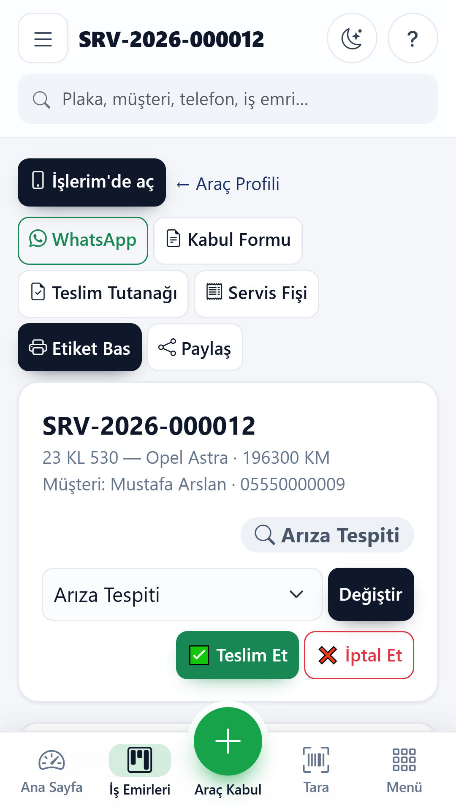

  

# AtomixServis

[English](#english) · [Türkçe](#türkçe)

  
  
  
  
  

## English

AtomixServis is the software I wrote for auto repair shops. It started as a web panel for keeping track of work orders and grew from there: vehicle intake, a job board, QR labels, stock, and now iOS and Android apps so the mechanics can use it from the workshop floor.

It's a commercial product, so the code is in a private repo. This page is just here to show what it does.

### What it does

- Opens a work order when a car comes in, with the customer, the vehicle, the complaint, the work done, parts and labour all in one place.
- Shows every car on a board by stage: just arrived, being worked on, waiting for parts, ready to go.
- Prints QR labels for cars and parts. Scan one with the phone and the record opens.
- Keeps track of stock. Parts used on a job come off the stock automatically.
- The mobile app connects to a shop with a company code or a QR code. Staff can update jobs and attach photos on the spot.
- Sends a notification when a job changes status. Notifications never include names or plate numbers, and the app can wipe its own data from the phone.

### Under the hood

The server side is PHP 8 with MySQL or SQLite. The apps are built with Capacitor 8 and plain JavaScript. iOS builds go through Codemagic, Android builds are Gradle AAB bundles, and the web side updates itself from signed packages. Each shop gets its own subdomain, hosted on cPanel behind Cloudflare.

Right now the web version is in daily use at shops, the iOS app is on the App Store, and the Android app is in closed testing on Google Play.

## Türkçe

AtomixServis oto servisler için yazdığım program. İş emirlerini takip etmek için bir web paneli olarak başladı, zamanla büyüdü: araç kabul, iş panosu, QR etiket, stok ve en son ustaların atölyede kullanabilmesi için iOS ve Android uygulamaları.

Ticari bir ürün olduğu için kodu özel depoda duruyor. Bu sayfa sadece ne yaptığını göstermek için var.

### Neler yapıyor

- Araç geldiğinde iş emri açılıyor; müşteri, araç, şikâyet, yapılan iş, parça ve işçilik aynı kayıtta.
- Bütün araçlar panoda aşamasına göre görünüyor: yeni geldi, işlemde, parça bekliyor, teslime hazır.
- Araç ve parçalar için QR etiket basılıyor. Telefonla okutunca kayıt açılıyor.
- Stok tutuluyor. İşte kullanılan parça stoktan kendiliğinden düşüyor.
- Mobil uygulama servise firma koduyla ya da QR ile bağlanıyor. Personel işi yerinde güncelleyip fotoğraf ekleyebiliyor.
- İşin durumu değişince bildirim gidiyor. Bildirimlerde isim ya da plaka yer almıyor, uygulama telefondaki verileri de kendisi silebiliyor.

### Altyapı

Sunucu tarafı PHP 8 ile MySQL ya da SQLite. Uygulamalar Capacitor 8 ve sade JavaScript ile yazıldı. iOS derlemeleri Codemagic'ten, Android derlemeleri Gradle AAB olarak çıkıyor; web tarafı da imzalı paketlerle kendini güncelliyor. Her servisin kendi alt alan adı var, cPanel üzerinde ve Cloudflare arkasında duruyor.

Şu an web sürümü servislerde her gün kullanılıyor, iOS uygulaması App Store'da, Android uygulaması Google Play'de kapalı testte.

---

atomiXbilişim · [atomixservis.com](https://atomixservis.com) · iletisim@atomixbilisim.com

© atomiXbilişim. All rights reserved. Tüm hakları saklıdır.
