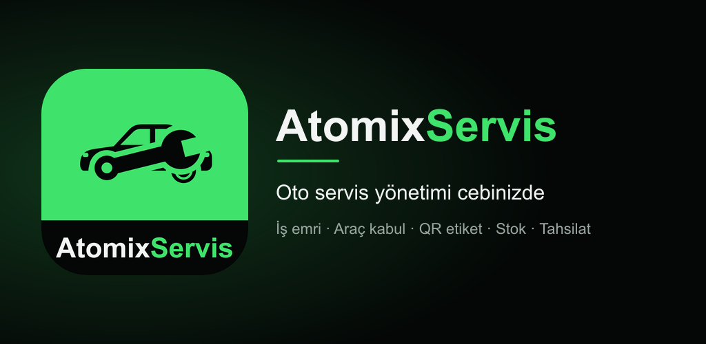
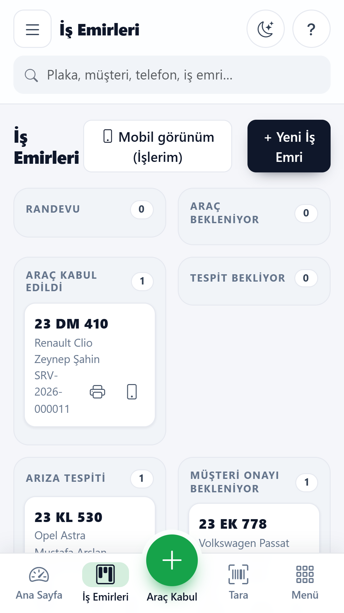
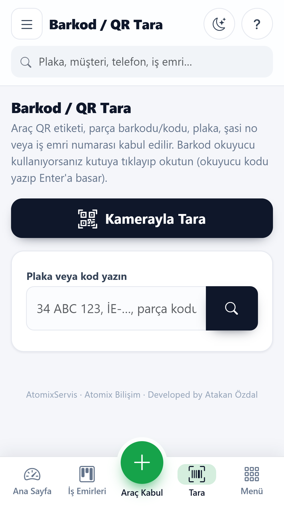

  

# AtomixServis

**Oto servisler için iş emri, araç kabul, QR etiket ve stok takibi.**
Web paneli + iOS / Android mobil uygulama. Elazığ'da, atomiXbilişim tarafından geliştiriliyor.

> Bu depo bir **vitrin** deposudur. AtomixServis ticari bir üründür; kaynak kodu gizli (private) depoda tutulur.

## Ekranlar

  
  
  
  
  

## Neler yapıyor

- **Araç kabul ve iş emri:** müşteri, araç, şikâyet, yapılan işlem, parça ve işçilik tek kayıtta
- **Kanban iş takibi:** araç hangi aşamada (kabul, işlemde, parça bekliyor, hazır) bir bakışta
- **QR etiket:** araca/parçaya etiket bas, telefonla okut, kayda anında ulaş
- **Stok takibi:** parça girişi/çıkışı, iş emrine bağlı stok düşümü
- **Mobil uygulama:** firma koduyla ya da QR ile bağlan, sahada iş emirlerini gör ve güncelle, fotoğraf ekle
- **Bildirimler:** iş durumu değiştiğinde ekibe haber
- **KVKK:** bildirim metinlerinde kişisel veri yok, uygulama içinden "bu telefondaki verileri sil"

## Teknoloji

| Katman | Kullanılan |
|---|---|
| Sunucu / web paneli | PHP 8, MySQL / SQLite |
| Mobil | Capacitor 8 (iOS + Android), vanilla JS |
| Derleme / dağıtım | Codemagic (iOS), Gradle AAB (Android), imzalı güncelleme paketleri |
| Barındırma | cPanel + Cloudflare, firma başına alt alan adı |

## Durum

- Web sürümü: firmalarda kullanımda
- iOS: App Store'da yayında
- Android: Google Play kapalı testte

## İletişim

**atomiXbilişim** · [atomixservis.com](https://atomixservis.com) · iletisim@atomixbilisim.com
Canlı demo için sitedeki "Demo" bağlantısını kullanabilirsiniz.

© atomiXbilişim. Tüm hakları saklıdır.
