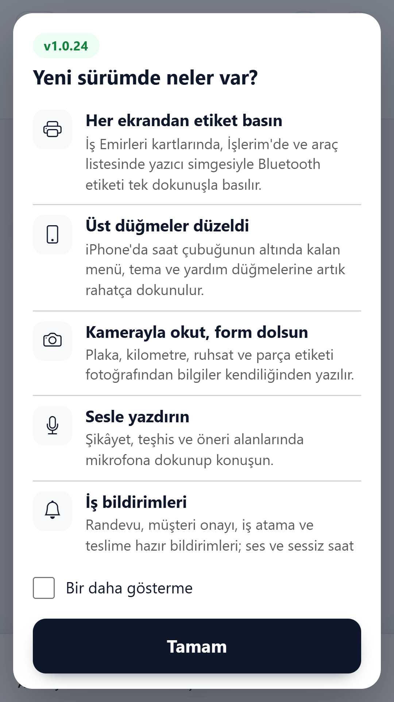
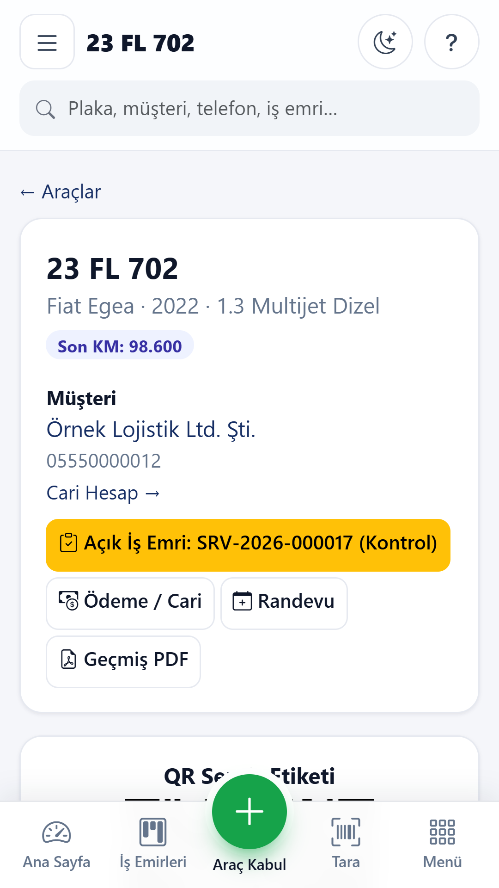

  

# AtomixServis

Oto servisler için iş emri, araç kabul, QR etiket ve stok yönetimi sunan servis yönetim yazılımı. Web paneli ile iOS ve Android uygulamalarından oluşur. Geliştirici: atomiXbilişim.

AtomixServis ticari lisansla sunulmaktadır. Bu depo ürün tanıtımı amacıyla oluşturulmuştur; kaynak kodu özel depoda tutulmaktadır.

## Ekran görüntüleri

  
  
  
  
  

## Modüller

| Modül | Kapsam |
|---|---|
| Araç kabul ve iş emri | Müşteri, araç, arıza tanımı, yapılan işlemler, parça ve işçilik bilgileri tek kayıt altında tutulur |
| İş takibi | Araçların kabul, işlemde, parça bekliyor ve teslime hazır aşamaları pano üzerinde izlenir |
| QR etiket | Araç ve parçalar için etiket basılır; etiket okutularak ilgili kayda doğrudan erişilir |
| Stok yönetimi | Parça giriş ve çıkışları kaydedilir, iş emrinde kullanılan parçalar stoktan otomatik düşülür |
| Mobil uygulama | Firma kodu veya QR ile bağlanılır; iş emirleri sahada görüntülenir, güncellenir ve fotoğraf eklenir |
| Bildirimler | İş durumundaki değişiklikler ilgili personele anlık iletilir |
| KVKK uyumu | Bildirimlerde kişisel veri yer almaz; kullanıcı cihazdaki verileri uygulama içinden silebilir |

## Teknik altyapı

| Katman | Teknoloji |
|---|---|
| Sunucu ve web paneli | PHP 8, MySQL, SQLite |
| Mobil uygulama | Capacitor 8 (iOS, Android), JavaScript |
| Derleme ve dağıtım | Codemagic (iOS), Gradle AAB (Android), imzalı güncelleme paketleri |
| Barındırma | cPanel, Cloudflare; her firma için ayrı alt alan adı |

## Yayın durumu

| Platform | Durum |
|---|---|
| Web | Firmalarda kullanımda |
| iOS | App Store'da yayında |
| Android | Google Play kapalı test aşamasında |

## İletişim

atomiXbilişim · [atomixservis.com](https://atomixservis.com) · iletisim@atomixbilisim.com

Ürün demosuna web sitesi üzerinden erişilebilir.

© atomiXbilişim. Tüm hakları saklıdır.
